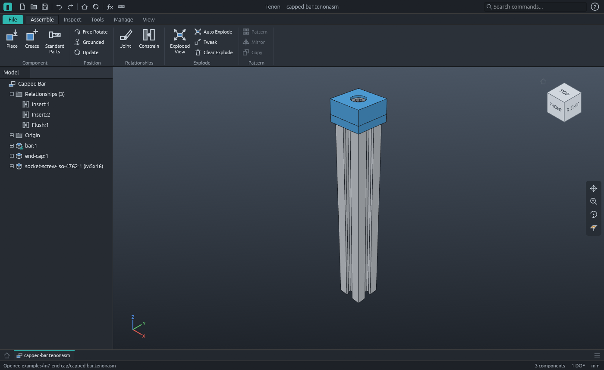
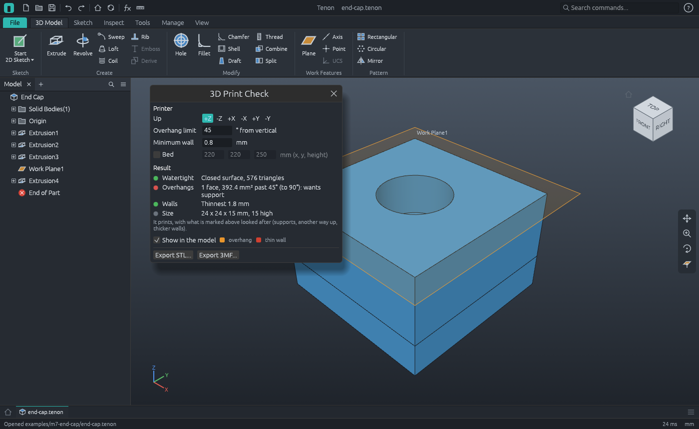
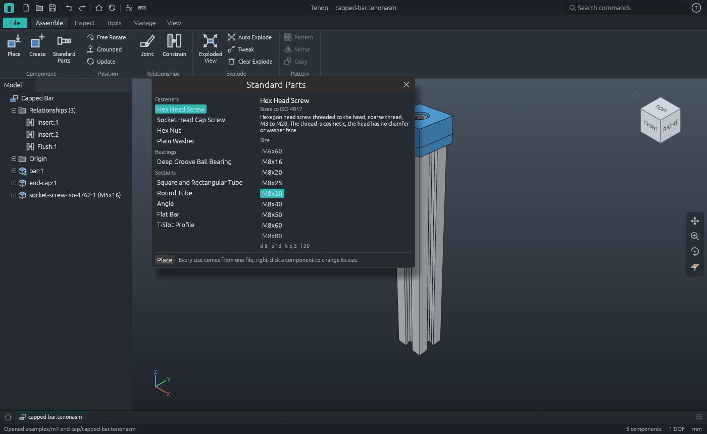

# M7 demo: a printed end cap on a T-slot bar



The maker's round trip, built by the command script [`end-cap.json`](end-cap.json): a part is
modelled, checked as a printer would take it and written out for a slicer; the bar it goes on
and the screw that holds it come from the standard parts library. Volumes, masses, the print
check's findings and the assembly are checked against their analytic values as the script runs.

| Part | File | Where it comes from | Material |
|---|---|---|---|
| End Cap | `end-cap.tenon` | modelled here | PLA |
| T-Slot Profile | `bar.tenon` | the library's 20 mm section, as a part of its own with its length set to 150 | Aluminium 6061 |
| Socket Head Cap Screw, M5x16 | `standard/socket-screw-iso-4762.tenon` | placed from the library, in a size | Steel, mild |

**The bar.** `library.new` starts a part from a standard one: the generic 20 mm T-slot section
(Tenon's own simplified profile, not a maker's drawing). It is an ordinary part. Its sizes are
the rows of a design table and its length is the parameter `L`, set here to 150 mm. The
section's area (400 less four slots and a 4.2 mm bore) times the length is 37 041.84 mm³.

**The cap.**

1. **Extrusion1**: a 24 × 24 × 10 mm block.
2. **Extrusion2**: a skirt 5 mm deep round the bar, 0.2 mm clear of it each side, so 1.8 mm
   thick. It is the ring between two squares drawn in one sketch.
3. **Extrusion3**: a 5.5 mm hole for an M5 screw.
4. **Extrusion4**: a 10 mm counterbore 6 mm deep for the screw's head, from a work plane on the
   top. 5992.93 mm³ in all, 7.43 g in PLA.



**Will it print?** `print.check` (Environments > 3D Print Check in the app) reads the part as
triangles, as a slicer will:

| Checked | Standing as drawn (skirt down) | Turned over (`up: "-z"`) |
|---|---|---|
| Watertight | yes | yes |
| Overhangs past 45° | the underside of the block, over the hollow of the skirt: 392.4 mm² | the floor of the counterbore: 54.7 mm², a ring a printer bridges |
| Thinnest wall | 1.8 mm, the skirt | the same |
| Fits a 220 × 220 × 250 bed | yes | yes, 15 mm high |

So it is printed with its flat top on the bed. Asked for 2 mm walls (a wide nozzle), the check
names the skirt's eight faces as too thin. In the app the faces found are tinted in the model:
overhangs orange, thin walls red.

**For the slicer.** `export.3mf` writes `end-cap.3mf`: millimetres, the material's name and
colour, one closed surface. `export.stl` writes `end-cap.stl`. Both keep the tolerance over the
whole surface.



**The assembly (`capped-bar.tenonasm`).** The bar is grounded. The cap is **inserted** on it
(the rim of its hole on the rim of the bar's bore: one relationship puts the two on one axis and
face to face) and its XZ plane kept **flush** with the bar's so it cannot turn. The screw is
placed from the library with `asm.insert_standard` (Assemble > Standard Parts in the app): its
file is written once into the folder `standard` beside the assembly, and every size comes from
that one file. It is inserted on the floor of the counterbore and left free to turn: one degree
of freedom in all.

`asm.interference` finds one overlap, and it is the one wanted: the screw's M5 thread in the
bar's 4.2 mm bore. As an M5 × 12 that is 8 mm of thread, π (2.5² − 2.1²) × 8 = 46.24 mm³: too
little for aluminium. `asm.set_row` makes the same component an M5 × 16 (right-click > Size in
the app): 12 mm of thread, 69.37 mm³, and still held where it was.

The parts list (`capped-bar-bom.csv`) names each part's material and mass: 111.9 g in all.
`asm.export_3mf` writes the whole assembly as `capped-bar.3mf`: an object for each part, an item
for each component where it is, each in its material's colour.

Regenerate (from the repository root):

```sh
pixi run cargo run -p tenon-cli -- run examples/m7-end-cap/end-cap.json --out examples/m7-end-cap
pixi run cargo run -p tenon -- examples/m7-end-cap/capped-bar.tenonasm
```

`tenon-cli demo m7 --out DIR` runs the same script. `apps/tenon-cli/tests/m7.rs` runs it in CI,
reads the 3MF and STL files back (closed surfaces of the right volume), reopens the assembly and
checks that the project files here are what the script writes.

| File | What |
|---|---|
| `end-cap.json` | The command script ([docs/scripts.md](../../docs/scripts.md)) |
| `end-cap.tenon`, `bar.tenon` | The parts |
| `standard/socket-screw-iso-4762.tenon` | The library's screw, every size in its design table |
| `capped-bar.tenonasm` | The assembly |
| `capped-bar-bom.csv` | The parts list, with materials and masses |
| `end-cap.3mf`, `end-cap.stl` | The cap for a slicer, millimetres |
| `capped-bar.3mf` | The assembly as 3MF |
| `bar.png`, `end-cap.png`, `capped-bar.png` | Software renders |
| `workbench.png` | `tenon examples/m7-end-cap/capped-bar.tenonasm --screenshot examples/m7-end-cap/workbench.png` |
| `print-check.png` | `tenon examples/m7-end-cap/end-cap.tenon --run inspect.print --screenshot examples/m7-end-cap/print-check.png` |
| `library.png` | `tenon examples/m7-end-cap/capped-bar.tenonasm --run tools.library --screenshot examples/m7-end-cap/library.png` |
