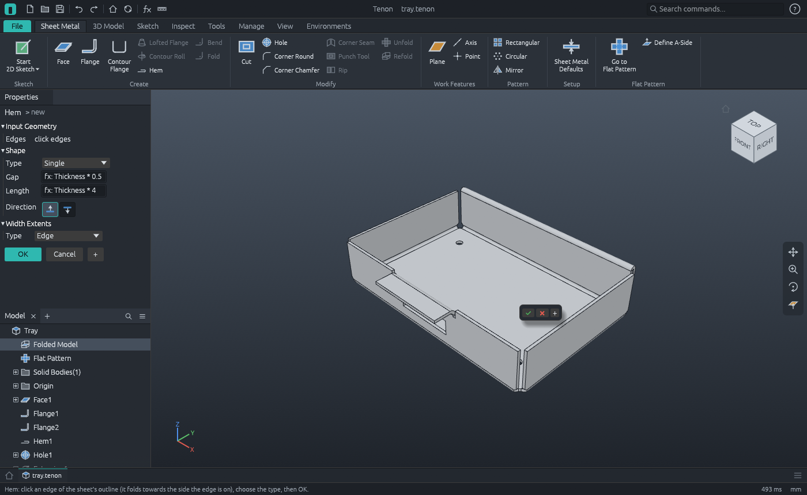

# M8 demo: a sheet metal tray, folded and laid flat


A tray for a small circuit board, cut from 1.5 mm aluminium and folded. It is built by the
command script [`tray.json`](tray.json): modelled folded, as it will be used, then laid flat
and written as the DXF a laser cutter takes. Every number the script checks is worked out by
hand below.

| File | What it is |
|---|---|
| `tray.tenon` | the part: a sheet metal rule, a face, two flanges, a hem, holes and a window |
| `tray-flat.dxf` | the flat pattern for a cutter: R12, millimetres, bend lines on their own layers |
| `tray-flat.svg` | the same as a picture at full size |
| `tray.step`, `tray.png` | the folded part |

## The rule

`sheet.defaults` (Sheet Metal > Sheet Metal Defaults) makes the part a sheet metal part. Its
sizes are parameters of the part, so they take equations, and everything follows the first:

| Parameter | Is | Here |
|---|---|---|
| `Thickness` | the sheet | 1.5 mm |
| `GapSize` | the gap left between flanges that meet at a corner | `Thickness` = 1.5 |
| `BendRadius` | inside radius of every bend | `Thickness` = 1.5 |
| `BendReliefWidth`, `BendReliefDepth` | the slot beside a bend narrower than its edge | 1.5 wide, 0.75 past the bend |
| `MinimumRemnant` | a strip beside a relief narrower than this goes too | 3 |
| `CornerReliefSize` | the relief where two bends meet | `Thickness * 4` = 6 |
| `KFactor` | where the sheet neither stretches nor shrinks in a bend | 0.44 |


## The part

1. **Face1**: a 120 × 80 rectangle on the XY plane, one thickness thick. 14 400 mm³.
2. **Flange1**: all four edges of the top in one flange, 25 high over all, bent 90°.
   The bend is placed *inside*: the wall's outer face goes through the edge, so the tray stays
   120 × 80 outside, and the floor is cut back by the radius and the thickness, 3 mm, on every
   side. Where two walls meet:
   - each bend starts where its neighbour's bend line crosses its own (3 along the edge);
   - the walls are **mitred**: they reach on towards the corner until `GapSize` is left
     between them. Their inner faces are 1.5 in from the edges, so they would meet 1.5 along;
     a gap of 1.5 across the corner takes 1.5 / √2 more from each: every wall ends
     **2.5607** from its corner;
   - the corner gets a **round relief** 6 across, laid out in the flat sheet: its centre is
     where the centre lines of the two bends cross. It takes the corner of the floor, the end
     of each bend and the foot of each wall.
3. **Flange2**: a tab 40 wide in the middle of the front wall's top, turned outwards 12, to fix
   the tray by. It is a flange on a flange. The edge picked is the *outer* edge of the wall's
   top, so it bends away from the tray. The wall is cut back 3 under it, with a relief slot
   1.5 wide and 3.75 deep on each side.
4. **Hem1**: the top of the back wall folded outwards and down, so that it is not sharp: a
   single hem with half a thickness between its layers (a fold of inside radius 0.375) and
   four thicknesses long over all. Nothing is cut for a hem: the fold starts at the edge.
5. **Hole1**: four 4 mm holes through the floor.
6. **Extrusion1**: a 30 × 8 window in the front wall, cut one `Thickness` each way from the
   plane of the wall's outer face.




### By hand

With t = 1.5, r = 1.5 and K = 0.44:

- a bend's cross-section is a quarter ring: π/4 × (3² − 1.5²) = 5.3014 mm²;
- a bend is as wide in the flat as its neutral surface is long, the **bend allowance**:
  π/2 × (r + K t) = π/2 × 2.16 = **3.3929 mm**. A piece of a bend with area A in the flat has
  volume A × 5.3014 / 3.3929 = 1.5625 A;
- a wall 25 high over all has 25 − (r + t) = 22 of flat wall above its bend; the tab, 12 − 3 = 9;
- the four walls are 2 × (120 + 80) − 8 × 2.5607 = **379.515** long in all;
- the hem's fold is half a ring, π/2 × (1.875² − 0.375²) = 5.3014 mm², and
  π × (0.375 + 0.66) = **3.2515** wide in the flat; the hem is 6 − 1.875 = 4.125 flat after it,
  and as long as the back wall: 120 − 2 × 2.5607 = **114.879**.

**A corner relief.** Seen in the flat of one flange (x out from where its bend starts, y along
its edge from the corner), the relief is a disc of radius R = 3 about (d, 3 − d), where
d = 1.6965 is half the bend allowance. The floor is x < 0 and y > 3, the bend 0 < x < 3.3929
and y > 3, the wall x > 3.3929 and y > 2.5607. With b = √(R² − d²) = 2.4743 and
F(s) = ½ (s √(R² − s²) + R² asin(s / R)), the disc takes

| | | mm² |
|---|---|---|
| of the floor | F(b) − F(d) − d (b − d) | 0.3398 |
| of each of the two bends | 2 F(d) − 2 d² | 3.8508 |
| of the foot of each of the two walls | F(b) − F(1.2571) − d (b − 1.2571) | 0.7400 |

(1.2571 is the wall's end, 2.5607 along the edge, measured from the disc's centre.)

| | Folded: volume (mm³) | Flat: area (mm²) |
|---|---|---|
| Floor, 114 × 74 | 8436 × 1.5 | 8436 |
| less four reliefs' share, 4 × 0.3398 | −1.359 × 1.5 | −1.359 |
| less four 4 mm holes | −50.265 × 1.5 | −50.265 |
| Four bends, 2 × (114 + 74) = 376 long | 3.3929 × 376 × 1.5625 | 3.3929 × 376 |
| less eight reliefs' shares, 8 × 3.8508 | −30.806 × 1.5625 | −30.806 |
| Four walls, 22 high, 379.515 long | 22 × 379.515 × 1.5 | 22 × 379.515 |
| less eight reliefs' shares, 8 × 0.7400 | −5.920 × 1.5 | −5.920 |
| less the window, 30 × 8 | −240 × 1.5 | −240 |
| less the wall under the tab, 3 × 40, and two slots 1.5 × 3.75 | −131.25 × 1.5 | −131.25 |
| The tab's bend, 40 long | 5.3014 × 40 | 3.3929 × 40 |
| The tab, 9 × 40 | 360 × 1.5 | 360 |
| The hem's fold, 114.879 long | 5.3014 × 114.879 | 3.2515 × 114.879 |
| The hem, 4.125 × 114.879 | 473.875 × 1.5 | 473.875 |
| **In all** | **28 551.89** | **18 944.59** |

At 2.68 g/cm³ the tray weighs 76.52 g. The script checks the volume after each feature, and
the mass at the end.

## The flat pattern


`sheet.flat_pattern` (Create Flat Pattern) gives the part a flat pattern, and `sheet.flat` says
what it is. It is worked out from the folded solid, not from the features: one side of the
sheet is followed from the floor across every bend, each face is laid in the plane, and the
edges left on the rim are the outline. So whatever is cut in the model is cut in the pattern;
a corner relief, which is cut square through a bend in the folded part, comes back as the arc
of the circle it was laid out as.

- **The sheet it is cut from:** 114 + 2 × (3.3929 + 22) = **164.786** long; 74 + the same, the
  tab's 9.393 beyond the front wall (its bend and its 9, less the 3 the wall was cut back) and
  the hem's 7.377 beyond the back one (its fold and its 4.125), **141.555** wide.
- **Six bends:** the four walls bend up, towards whoever looks into the tray; the tab and the
  hem bend down, away from them. A wall's bend is 3.3929 wide, the hem's fold 3.2515.
- **Five cut-outs:** four holes and the window. The corner reliefs are bites out of the
  outline: at each corner one arc of radius 3 runs from the end of one wall to the end of the
  next, 3 × (3π/2 − 2 asin(1.2571 / 3)) = 11.543 long.
- **To cut:** 768.27 mm. Each wall's end is 25.393 − 4.420 = 20.973 long where the relief
  leaves it, so the cross is 4 × (2 × 20.973 + 11.543) + 379.515 = 593.47 round; the tab and
  its slots add 33.79, the hem's two ends 14.75; the holes are 50.27, the window 76.

`sheet.export_dxf` writes it for a cutter: lines, arcs and circles only, in millimetres, with
its lower left corner at the origin.

| Layer | Holds |
|---|---|
| `OUTER` | the outline: 20 lines and the four arcs of the corner reliefs |
| `INTERIOR` | the cut-outs: four circles and the window |
| `BEND_UP`, `BEND_DOWN` | the centre line of each bend: four up, two down |
| `BEND_EXTENT` | where each bend begins and ends |

The last step of the script makes the sheet 2 mm thick by setting `Thickness`: the radius, the
gap, the reliefs, the face, the walls, the tab, the hem and the window's depth all follow, and
the pattern is 163.048 long.

## Regenerating

```bash
tenon-cli run examples/m8-tray/tray.json --out examples/m8-tray
```

or `tenon-cli demo m8 --out DIR`. The pictures of the workbench are screenshots:

```bash
tenon examples/m8-tray/tray.tenon --screenshot workbench.png --size 1400x860
tenon examples/m8-tray/tray.tenon --run sheet.flat_view --screenshot flat-pattern.png --size 1400x860
tenon examples/m8-tray/tray.tenon --run sheet.flange --screenshot flange.png --size 1400x860
tenon examples/m8-tray/tray.tenon --run sheet.hem --screenshot hem.png --size 1400x860
tenon examples/m8-tray/tray.tenon --run sheet.defaults --screenshot defaults.png --size 1400x860
```
