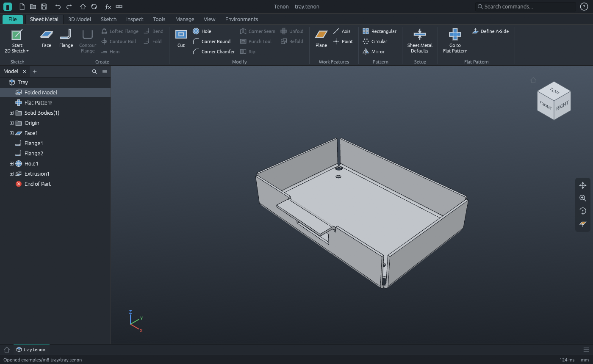
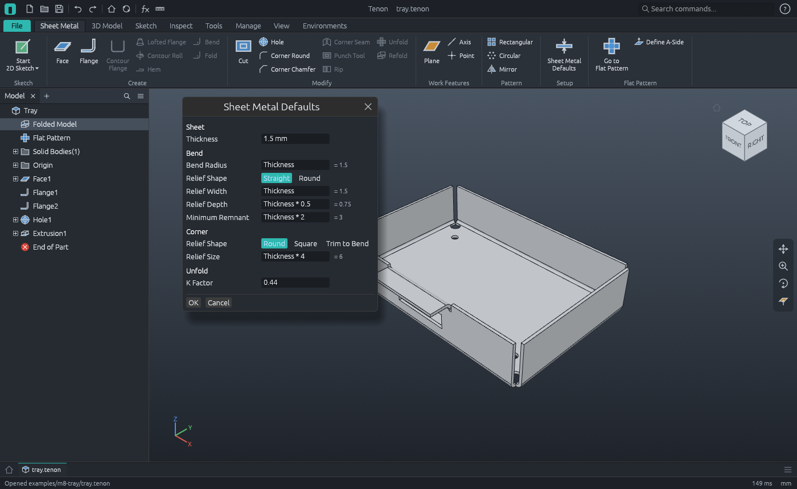
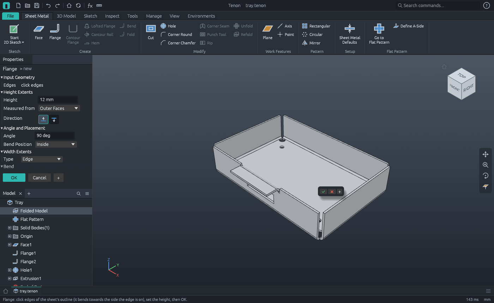
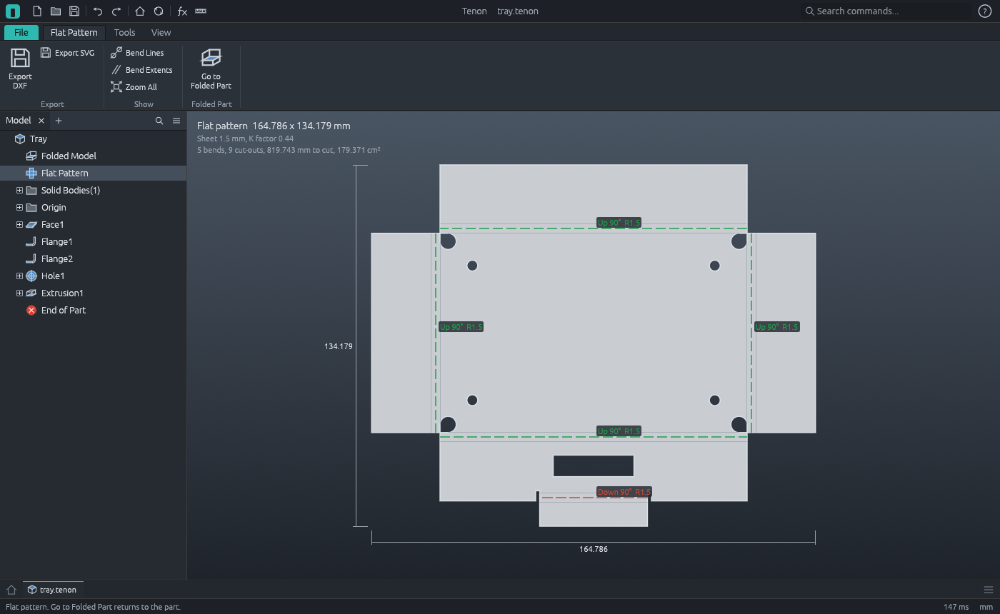

# M8 demo: a sheet metal tray, folded and laid flat



A tray for a small circuit board, cut from 1.5 mm aluminium and folded. It is built by the
command script [`tray.json`](tray.json): modelled folded, as it will be used, then laid flat
and written as the DXF a laser cutter takes. Every number the script checks is worked out by
hand below.

| File | What it is |
|---|---|
| `tray.tenon` | the part: a sheet metal rule, a face, two flanges, holes and a window |
| `tray-flat.dxf` | the flat pattern for a cutter: R12, millimetres, bend lines on their own layers |
| `tray-flat.svg` | the same as a picture at full size |
| `tray.step`, `tray.png` | the folded part |

## The rule

`sheet.defaults` (Sheet Metal > Sheet Metal Defaults) makes the part a sheet metal part. Its
sizes are parameters of the part, so they take equations, and everything follows the first:

| Parameter | Is | Here |
|---|---|---|
| `Thickness` | the sheet | 1.5 mm |
| `BendRadius` | inside radius of every bend | `Thickness` = 1.5 |
| `BendReliefWidth`, `BendReliefDepth` | the slot beside a bend narrower than its edge | 1.5 wide, 0.75 past the bend |
| `MinimumRemnant` | a strip beside a relief narrower than this goes too | 3 |
| `CornerReliefSize` | the relief where two bends meet | `Thickness * 4` = 6 |
| `KFactor` | where the sheet neither stretches nor shrinks in a bend | 0.44 |



## The part

1. **Face1**: a 120 × 80 rectangle on the XY plane, one thickness thick. 14 400 mm³.
2. **Flange1**: all four edges of the top in one flange, 25 high over all, bent 90°.
   The bend is placed *inside*: the wall's outer face goes through the edge, so the tray stays
   120 × 80 outside, and the floor is cut back by the radius and the thickness, 3 mm, on every
   side. Each wall starts where its neighbour's bend line crosses its own, and each corner of
   the floor gets a round relief: a hole 6 across that touches both bend lines, opened to the
   corner.
3. **Flange2**: a tab 40 wide in the middle of the front wall's top, turned outwards 12, to fix
   the tray by. It is a flange on a flange. The edge picked is the *outer* edge of the wall's
   top, so it bends away from the tray. The wall is cut back 3 under it, with a relief slot
   1.5 wide and 3.75 deep on each side.
4. **Hole1**: four 4 mm holes through the floor.
5. **Extrusion1**: a 30 × 8 window in the front wall, cut one `Thickness` each way from the
   plane of the wall's outer face.



### By hand

With t = 1.5, r = 1.5 and K = 0.44:

- a bend's cross-section is a quarter ring: π/4 × (3² − 1.5²) = 5.3014 mm²;
- a bend is as wide in the flat as its neutral surface is long, the **bend allowance**:
  π/2 × (r + K t) = π/2 × 2.16 = **3.3929 mm**;
- a wall 25 high over all has 25 − (r + t) = 22 of flat wall above its bend; the tab, 12 − 3 = 9.

| | Folded: volume (mm³) | Flat: area (mm²) |
|---|---|---|
| Floor, 114 × 74 | 8436 × 1.5 | 8436 |
| less four corner reliefs, each 3² + ¾ π 3² = 30.206 | −120.823 × 1.5 | −120.823 |
| less four 4 mm holes | −50.265 × 1.5 | −50.265 |
| Four bends, 2 × (114 + 74) = 376 long | 5.3014 × 376 | 3.3929 × 376 |
| Four walls, 22 high | 22 × 376 × 1.5 | 22 × 376 |
| less the window, 30 × 8 | −240 × 1.5 | −240 |
| less the wall under the tab, 3 × 40, and two slots 1.5 × 3.75 | −131.25 × 1.5 | −131.25 |
| The tab's bend, 40 long | 5.3014 × 40 | 3.3929 × 40 |
| The tab, 9 × 40 | 360 × 1.5 | 360 |
| **In all** | **26 993.89** | **17 937.12** |

At 2.68 g/cm³ the tray weighs 72.34 g. The script checks the volume after each feature, and
the mass at the end.

## The flat pattern



`sheet.flat_pattern` (Create Flat Pattern) gives the part a flat pattern, and `sheet.flat` says
what it is. It is worked out from the folded solid, not from the features: one side of the
sheet is followed from the floor across every bend, each face is laid in the plane, and the
edges left on the rim are the outline. So whatever is cut in the model is cut in the pattern.

- **The sheet it is cut from:** 114 + 2 × (3.3929 + 22) = **164.786** long; 74 + the same, and
  the tab's 9.393 beyond the front wall (its bend and its 9, less the 3 the wall was cut back),
  **134.179** wide.
- **Five bends:** the four walls bend up, towards whoever looks into the tray; the tab bends
  down, away from them. Each is 3.3929 wide.
- **Nine cut-outs:** four holes, four corner reliefs, the window.
- **To cut:** 819.74 mm. The outline is the cross's 579.14 and 33.79 more round the tab and its
  slots; the holes 50.27, the window 76, the reliefs 20.14 each.

`sheet.export_dxf` writes it for a cutter: lines, arcs and circles only, in millimetres, with
its lower left corner at the origin.

| Layer | Holds |
|---|---|
| `OUTER` | the outline: 20 lines |
| `INTERIOR` | the cut-outs: four circles, the window, the four reliefs (two lines and an arc each) |
| `BEND_UP`, `BEND_DOWN` | the centre line of each bend: four up, one down |
| `BEND_EXTENT` | where each bend begins and ends |

The last step of the script makes the sheet 2 mm thick by setting `Thickness`: the radius, the
reliefs, the face, the walls, the tab and the window's depth all follow, and the pattern is
163.048 long.

## Regenerating

```bash
tenon-cli run examples/m8-tray/tray.json --out examples/m8-tray
```

or `tenon-cli demo m8 --out DIR`. The pictures of the workbench are screenshots:

```bash
tenon examples/m8-tray/tray.tenon --screenshot workbench.png --size 1400x860
tenon examples/m8-tray/tray.tenon --run sheet.flat_view --screenshot flat-pattern.png --size 1400x860
tenon examples/m8-tray/tray.tenon --run sheet.flange --screenshot flange.png --size 1400x860
tenon examples/m8-tray/tray.tenon --run sheet.defaults --screenshot defaults.png --size 1400x860
```
